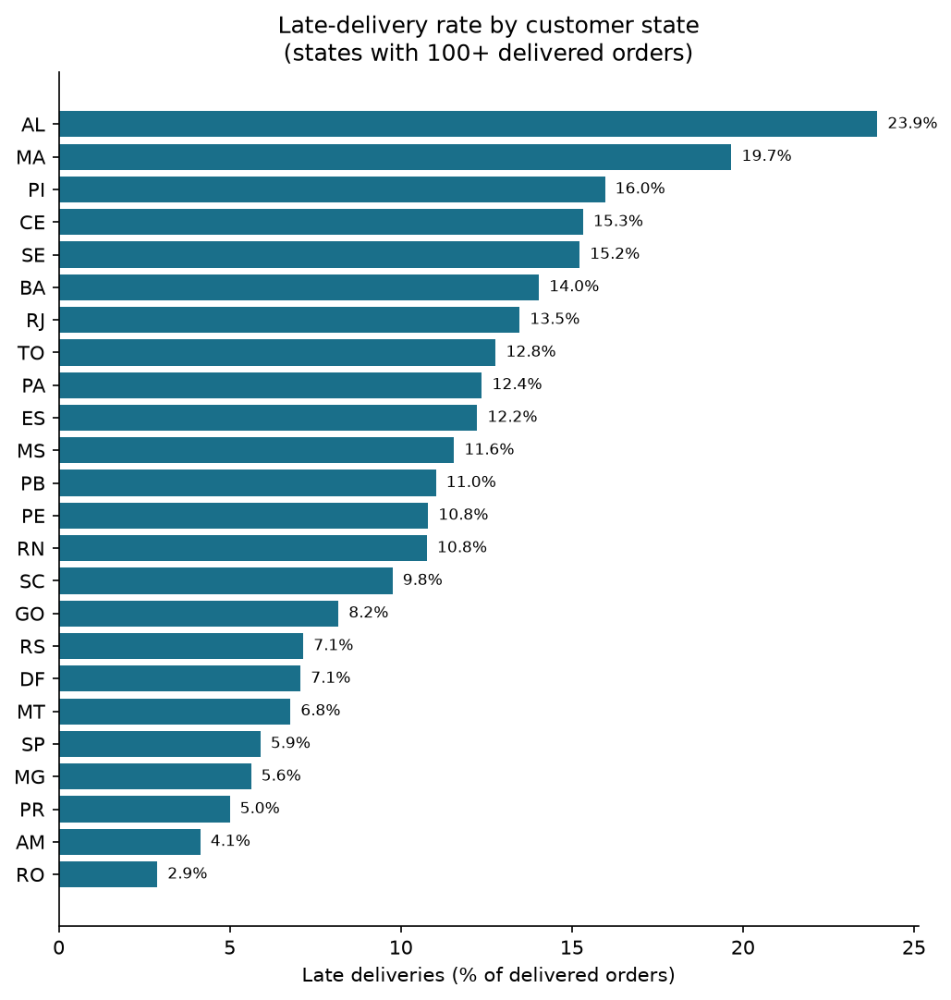
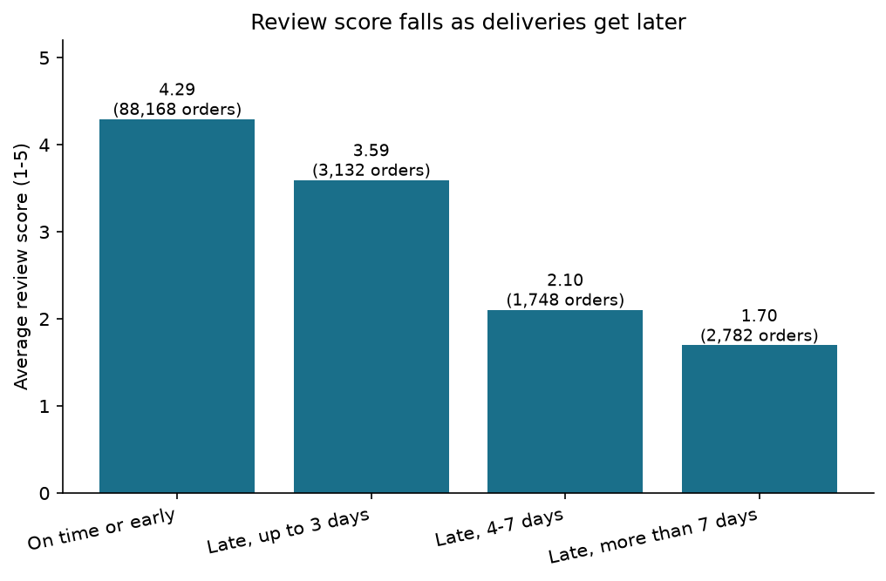

# Olist E-commerce Data Warehouse

A PostgreSQL star-schema warehouse built with a Python ETL pipeline on the public
Olist Brazilian e-commerce dataset. Goal: answer one business question, **do late
deliveries hurt customer reviews, and where?**

## What the pipeline does
1. **Extract** 8 source CSV files with pandas
2. **Transform** types and dates, add English category names, calculate `delivery_days`, `delay_days` and `is_late`
3. **Validate** with 29 data-quality rules; rejected rows go to a `quarantine` table with the reason
4. **Load** a star schema into PostgreSQL in one transaction (safe to re-run)
5. **Reconcile** row counts and totals between source files and warehouse

## Results of the latest run
- 112,650 order items, 103,886 payments, 99,441 orders loaded
- 6 warehouse tables (4 dimensions, 2 facts) plus quarantine and run-log tables
- 29 validation rules and 4 reconciliation checks, all passing
- Full pipeline runtime: about 58 seconds

## Run it
```
docker compose up -d
pip install pandas sqlalchemy psycopg2-binary
docker cp sql/schema.sql olist_db:/schema.sql
docker exec olist_db psql -U olist -d olist -f /schema.sql
python -m etl.run_pipeline
```
Download the dataset from Kaggle ("Brazilian E-Commerce Public Dataset by Olist")
and place the CSV files in `data/raw/`.

## Next steps
Index benchmarks, scheduling with Airflow, larger-scale processing with Spark.

## Findings (96,476 delivered orders)
- **8.11%** of delivered orders arrived after the estimated date.
- Late orders average **2.57** stars against **4.29** for on-time orders, a gap of 1.72 points.
- Late rates range from **23.9% in Alagoas** and **19.7% in Maranhão** down to **5.9% in São Paulo** and **2.9% in Rondônia**.
- Review scores fall as delays grow: **4.29** on time, **3.59** up to 3 days late, **2.10** for 4-7 days late and **1.70** for more than 7 days late.
- These are associations in the data, not proof that lateness alone causes low scores.





Queries are in `sql/analytics.sql`; charts are made by `analysis/charts.py`.