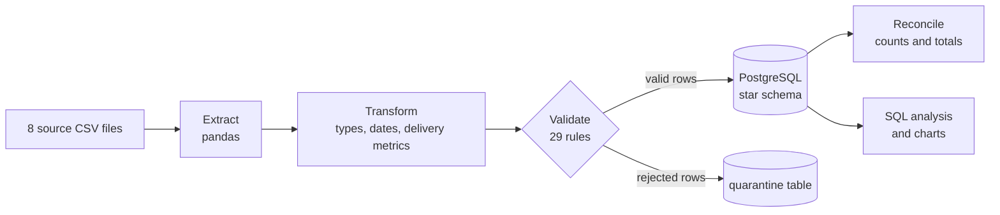
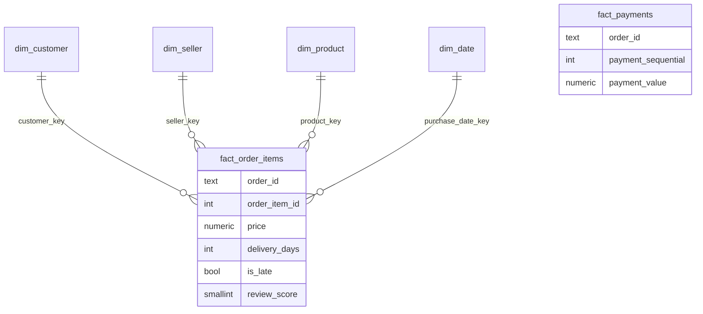

<h1 align="center">Olist E-commerce Data Warehouse</h1>

<p align="center">
  A Python ETL pipeline that turns 8 messy marketplace files into a validated PostgreSQL star schema,<br/>
  then uses it to answer one question: <b>do late deliveries hurt customer reviews?</b>
</p>

<p align="center">
  
  
  
  
  
</p>

## 🎯 The problem
An online retailer keeps orders, payments, customers, sellers and reviews in separate files, and some of the data is wrong.
Nobody can answer "why are our ratings dropping?" until the data is joined, cleaned and trusted.
This project builds that trusted layer and then uses it to find out where deliveries go wrong.

## 📊 At a glance
| | |
|---|---|
| Order items loaded | **112,650** |
| Payments loaded | **103,886** |
| Orders / customers | **99,441** each |
| Warehouse tables | **6** (4 dimensions, 2 facts) |
| Data-quality rules | **29** |
| Reconciliation checks | **4**, all passing |
| Full pipeline run | **about 58 seconds** |

## 🔄 How the pipeline works


1. **Extract**: read every file as text so zip codes keep leading zeros
2. **Transform**: fix types and dates, add English category names, calculate `delivery_days`, `delay_days` and `is_late`
3. **Validate**: 29 rules (missing keys, duplicates, impossible dates, orphan records); failing rows go to a `quarantine` table with the reason. No row broke a rule on this dataset.
4. **Load**: truncate and reload everything in one transaction, so a re-run gives the same result and a failure leaves the old data untouched
5. **Reconcile**: source row counts and totals must equal warehouse plus quarantine, or the run fails

## 🗂️ Warehouse design


## 🔎 Findings (96,476 delivered orders)
- **8.11%** of delivered orders arrived after the estimated date.
- Late orders average **2.57** stars against **4.29** for on-time orders, a gap of 1.72 points.
- Late rates range from **23.9% in Alagoas** and **19.7% in Maranhão** down to **5.9% in São Paulo** and **2.9% in Rondônia**.
- Review scores fall as delays grow: **4.29** on time, **3.59** up to 3 days late, **2.10** for 4-7 days late and **1.70** for more than 7 days late.
- These are associations in the data, not proof that lateness alone causes low scores.


## 📁 Project structure
```
etl/                extract, transform, validate, load, reconcile, run_pipeline
sql/                schema.sql, analytics.sql
analysis/           charts.py
reports/            quality report and charts
docker-compose.yml  PostgreSQL service
```

## ▶️ Run it
<details>
<summary>Show commands</summary>

```
docker compose up -d
pip install pandas sqlalchemy psycopg2-binary matplotlib
docker cp sql/schema.sql olist_db:/schema.sql
docker exec olist_db psql -U olist -d olist -f /schema.sql
python -m etl.run_pipeline
python analysis/charts.py
```
Download the dataset from Kaggle ("Brazilian E-Commerce Public Dataset by Olist") and place the CSV files in `data/raw/`.
</details>

## 🛣️ Roadmap
- [x] Star-schema design and Python ETL
- [x] Validation rules and reconciliation checks
- [x] SQL analysis and charts
- [ ] Index benchmarks (before and after timings)
- [ ] Scheduling with Airflow
- [ ] Larger-scale processing with Spark

## 🙏 Data
[Brazilian E-Commerce Public Dataset by Olist](https://www.kaggle.com/datasets/olistbr/brazilian-ecommerce) on Kaggle.